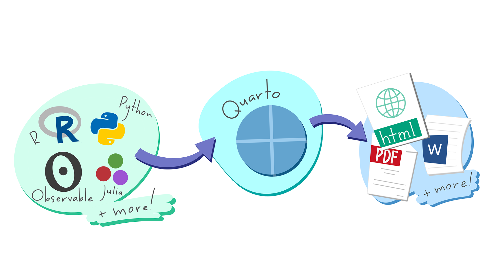
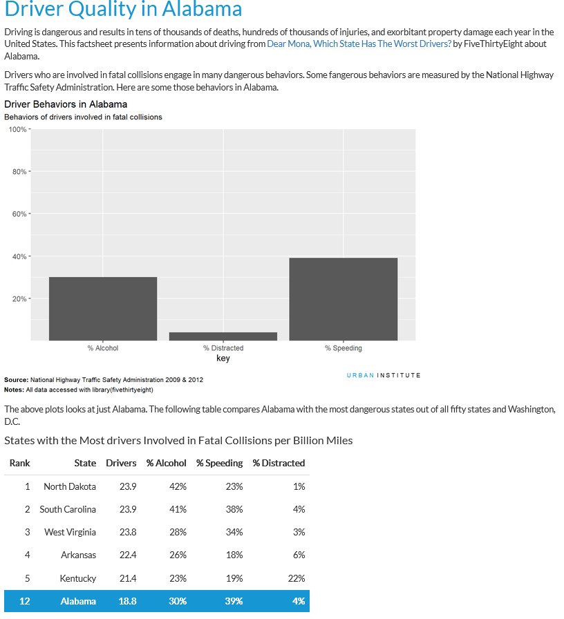
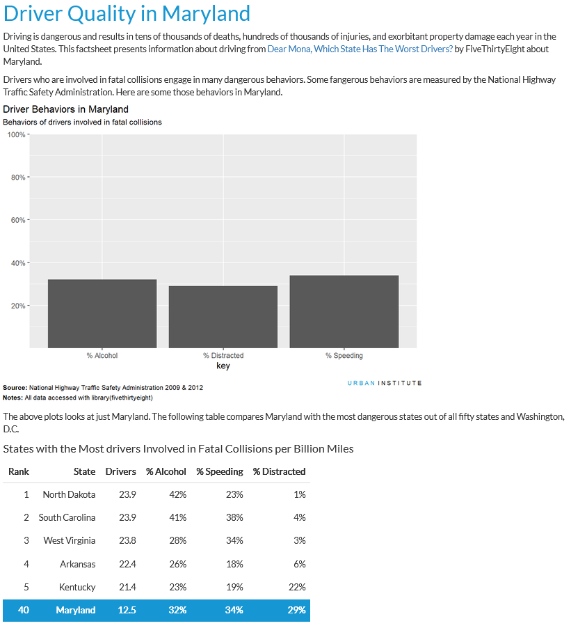
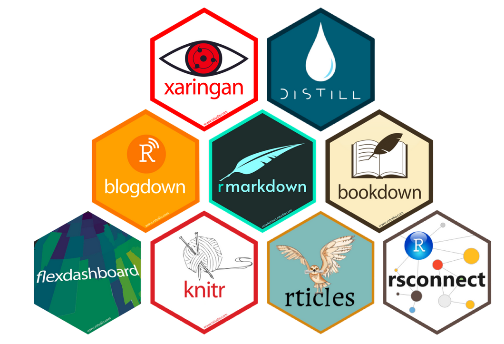
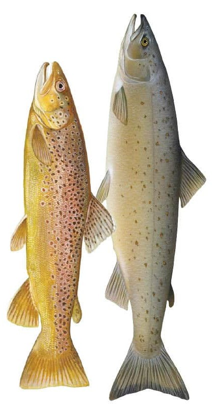

## About Data Services {.center style="text-align: center"}

We help faculty, researchers, and students find, use, manage, visualize and share data.

<https://dataservices.library.jhu.edu/>

dataservices\@jhu.edu

## Today

::::: columns
::: {.column width="50%"}
-   What is Quarto

-   Quarto basics

-   Converting an R script to a Quarto document

-   Parameterizing & automating Quarto documents
:::

::: {.column width="50%"}
{fig-align="center"}
:::
:::::

## You should have:

-   R & RStudio installed, as well as the `tidyverse`, `quarto`, `knitr` and `scales` packages installed.

-   Experience using R (optional, but helpful)

-   A .zip folder containing:

    -   `data` folder

    -   An R script, `salmonid_analysis.R` that we will turn into a Quarto document today

    -   A helper script for the section on parameterizing Quarto documents, `render_salmonid_reports.R`

        ::: notes
        -   Go over unzipping the folder and explain each thing
        :::

## Why Quarto?

With Quarto, you can save and share the results of your analysis (code, results, tables, visualizations, documentation) in a readable format (.html, .pdf, .docx, .pptx, and more)

{fig-align="center" width="2493"}

::: notes
-   We're focusing on R today, but Quarto can also run Python, Julia, and more via the jupyter engine / reticulate package, and you can combine different programming languages within one report
:::

## Why Quarto?

Use parameters to re-run different versions of the same analysis, without re-writing all of your code.

::::: columns
::: {.column width="50%"}
{fig-align="center"}
:::

::: {.column width="50%"}
{fig-align="center"}
:::
:::::

::: notes
-   Regenerating a report with updated data.

-   Running a report that covers a specific time period.

-   Running a single analysis multiple times under different conditions.
:::

## Quarto vs. RMarkdown

::::: columns
::: {.column width="50%"}
-   Quarto is the next generation of RMarkdown

-   User-friendly visual editor, no need for additional package installations to create different output types
:::

::: {.column width="50%"}
{fig-align="center"}
:::
:::::

::: notes
-   If you are familiar with RMarkdown, you can think of Quarto as an evolution of RMarkdown.

-   The core ideas of RMarkdown were really sound and posed huge possibilities for reproducibility in research - but was limited to R, and operated almost entirely on workarounds to make anything other than a general document

-   Quarto built on the creativity of the R community and implemented spinoffs for slides (xaringen), books (bookdown), websites (blogdown), and dashboards (Shiny) etc. more formally

-   Compared to RMarkdown, Quarto offers expanded options for **inputs** (support for more programming languages than R), and more **outputs** (not just documents, but slides, websites, books, manuscripts. and more)

-   These slides are Quarto, the course website is Quarto - only going to focus on documents today, but the great thing about Quarto is that once you learn the basics its easy to create other output types
:::

## Today's scenario

You have developed an R script for your lab that compiles and visualizes **salmonid mortality data** in Norway.

Your labmates find this summary very useful and they would like to receive a **monthly summary of data from the last 12 months**. Different teams within the lab focus on different species and want their report **tailored to that species**.

{fig-align="right"}

## Without Quarto

-   Let's look at `salmonid_analysis.R`

-   To generate the reports we've been asked for, we would have to:

    -   Manually update the data path and species throughout our code for each new report.

    -   Copy and paste the relevant numbers and output into a document every time we ran the report.

::: notes
-   Go through creating an RProject from the unzipped directory

-   Open R script and run through it
:::

## From R script to Quarto document

Let's create a new Quarto document:

-   Give the document a title

-   Select HTML output, which can be opened in any browser. Creating PDFs requires LaTeX (a high-volume installation) and Word documents require Word

-   Select Knitr as our engine, since we are working in R. The Jupyter engine can render R and Python in one document (with some caveats)

    ::: notes
    -   Open Quarto, create new document, go over output options and select HTML, select Knitr
    :::

## YAML Header

-   The YAML header controls the document format and is automatically generated based on options you select when creating your document.

-   There are thousands of YAML header options that vary by output type, a good reference [here](https://quarto.org/docs/reference/).

-   Let's edit the YAML header to add ourselves as the author of this document

    ::: notes
    -   Go over the YAML header. YAML is a markup language that is interpreted by the Quarto engines. The YAML header controls the document format and there are thousands of options for how Quarto can display things, listed here <https://quarto.org/docs/reference/> (describe how to navigate this based on

    -   Acknowledge YAML header, add author, look at options, say we will come back to this
    :::

## Adding text ✒️

-   Create headings and text by typing in the visual editor

-   Let's add a heading and paragraph to the top of our document to describe the first number we will calculate in our report: number of salmonid losses.

    ::: notes
    -   Create title, paragaph about number of losses
    :::

## Code chunks 🤖

-   Insert executable code with `Insert > Executable Cell`

-   Specify options for displaying code chunks with `#|` at the beginning of the code chunk. Available options are described [here](https://quarto.org/docs/computations/execution-options.html).

-   Let's add our calculation for salmonid losses to the report as a code chunk.

::: notes
-   Insert code chunk

-   Add first several lines of code and render document, point out the output from loading in the libraries that we don't want, but we do want the output from the number of losses

-   Break up into two chunks and use `#|` to label them and assign options - open <https://quarto.org/docs/computations/execution-options.html> and go over options

-   set `include: FALSE` in the first cell and `echo:FALSE` in the second cell. Render the document again and show the change in output.
:::

## Inline code ⛸️

-   You can add inline code to your document text with the syntax \``{r} 2 + 2`\`

-   The above will render in your Markdown to 4

-   Let's take the losses calculation from our code chunk and add it to our paragraph as inline code.

::: notes
-   make code inline - move the cell above the text and explain why, type `r losses` and render to show inline code
:::

## Other outputs: Tables & visualizations 📅📊

Quarto can display any kind of output from your code - including tables and visualizations.

The `kable()` function from Knitr creates display-ready tables from R output.

Let's insert two code chunks - one to display our table of losses over time and another to display our chart of losses by county.

::: notes
-   paste the code for the table in and ask which options we should set

-   label chunk and set `echo: FALSE` , render report

-   install/load knitr and pipe the table into kable

-   Note the warning that is popping up - we want the table output, but not the warnings - have to add the option `warning: FALSE` to achieve this

-   column names, caption can be adjusted with kable - link documentation

-   add in the viz code, add the echo and warning options
:::

## Parameters 

-   Now we have a report about rainbow trout that we can share with our lab - but remember, our dataset contains multiple species!

-   We can use Quarto **parameters** to easily re-run our report for a different species.

-   Parameters are defined in the YAML header using the `params` option.

-   Lets add a parameter to the YAML header for species.

::: notes
-   we know we want to run this for each species, we have salmon and rainbow trout in our dataset

-   Add a Quarto parameter for species and replace "rainbowtrout" with references to this parameter

-   Render the document, then replace the parameter with "salmon" and render again

-   Note that the html output has been overwritten note that Quarto does not yet have a way to automate this without an external script, which we will look at later

-   write a little header at the top noting what species the report is for and add the species name to text as a parameter
:::

## Using parameters to read in data

-   In 6 months, your team asks to you re-generate the report with current data. They also like to get the report monthly from here on out

-   Since the datafile will be updated each time we run the report, let's use a parameter for it so we only have to update the parameters for each report.

::: notes
-   First just put the whole filepath in parameter

-   Lets say the data export always has this naming structure with the end date in the filename - make the parameter the end date instead, changes the readcsv code to paste0

-   Now we can use that parameter elsewhere - add date range to summary and descriptions
:::

## Looping over parameters ➿

-   So far we've updated the parameters one at a time in the YAML header, and it hasn't been too much effort because we only have 2 species

-   What if we had a longer list of species, and every time we got new data we wanted to generate one report per species?

-   The two things we need to do here are loop over a list of parameters and use those parameters to name our output quarto document. We can't do either of those things within the Quarto document itself, but a simple script is provided in `render_salmonid_reports.R`

## thank you! 😊

Please let us know what you thought of this workshop at our [survey](https://jh.qualtrics.com/jfe/form/SV_e3UQpWkHBRmsh38) (QR code below.)

Any questions?

{fig-align="right"}
